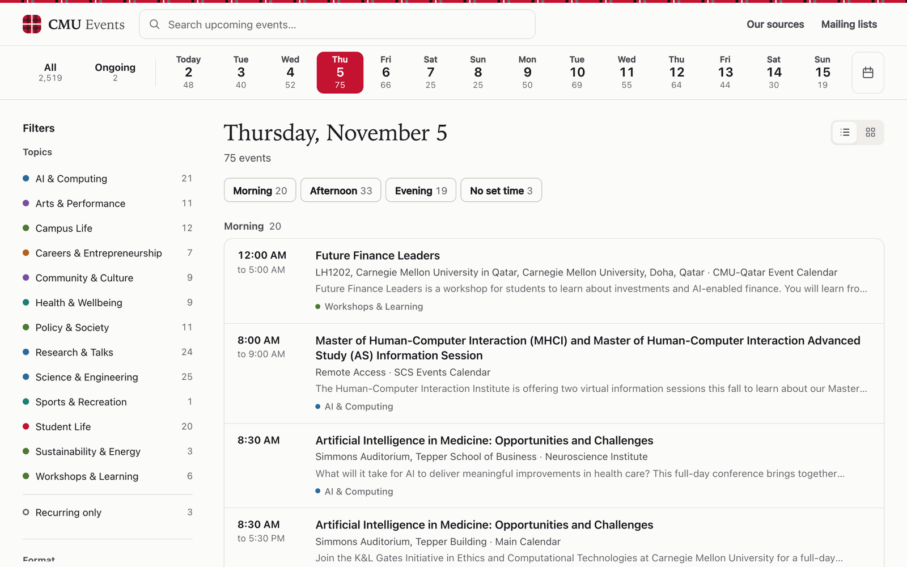

# CMU Events

Find out what's happening at Carnegie Mellon without checking dozens of separate calendars. CMU Events brings public events from university calendars, academic departments, research centers and offices into one searchable list that refreshes every morning.

**[Explore CMU Events](https://oransimon.github.io/CMUEvents/)**

[](https://oransimon.github.io/CMUEvents/)

Events come from 318 catalogued public sources, from the main university calendar to individual department pages, seminar series and feeds. Each event links back to its original listing, so registration and the latest details are always one click away.

## Features

- **Search everything upcoming.** Search titles, descriptions, locations, organizers, departments and topics across every event from today onward. Results are ranked by best match, and longer words tolerate small typos.
- **Browse by day.** Start with today's events grouped into morning, afternoon and evening. Step through the next two weeks on the date strip, or jump to any date up to a year ahead. **Ongoing** collects exhibitions and programs that run for several days, sorted by how soon they end.
- **Filter to what matters.** Narrow the list by topic, campus, department, organization or format (in person, online or hybrid). Counts update as you filter, and the page address keeps your choices so you can bookmark or share a view.
- **Go to the source.** Open any event for its time, place and summary, then follow the link to the original listing for registration and tickets. An event reposted by several calendars appears once, with every original link kept.
- **See where events come from.** **Our sources** lists every calendar and feed the site reads. **Mailing lists** points to groups that announce some events only by email.
- **Know how fresh it is.** The page shows when the data was last updated and warns you if an update is overdue. It works on phones and follows your system's light or dark theme.

## How it works

1. Every morning, a scheduled GitHub Actions workflow reads each public source, including calendar feeds, event pages, newsletters, PDFs and posters, and converts the listings into one format.
2. Reposts of the same event are combined. Notices that aren't activities, such as deadlines and registration windows, are set aside. Each event gets broad topic, campus and format labels.
3. The result is checked before it goes live. If collection fails widely or the event count drops sharply, the previous version stays online.
4. The site is published to GitHub Pages as static files, and search runs in your browser. There's nothing to install and no account needed.

## Coverage and limitations

- **Publisher sources only.** The site collects from university calendars, academic departments, research centers, offices, student governance and similar publishers. Independent student-club websites and their own calendar feeds are not collected directly. Club activities still appear when an included source, such as the public TartanConnect calendar, publishes them.
- **Not every CMU event.** Sources can change format, restrict access or be temporarily unavailable. When a source fails, its last successful events are kept and the problem is visible in **Our sources**. Announcements sent only to mailing lists are not included.
- **Source counts.** The 318 sources are catalog entries, not organizations: one organization can publish several pages and feeds.
- **Dates and times.** The collection covers the past 30 days through the next year. Times are shown in Eastern Time (America/New_York).
- **Labels are automatic.** Topic, campus and format labels are inferred from the event text and can be wrong. The original listing is the authority on registration, eligibility, tickets and last-minute changes. Some events require registration or are restricted to certain audiences.

## Development

### Use the website

Nothing needs to be installed to browse events. Open [oransimon.github.io/CMUEvents](https://oransimon.github.io/CMUEvents/).

### Run the project locally

You need Node.js 24, the version used in CI.

```bash
git clone https://github.com/OranSimon/CMUEvents.git
cd CMUEvents
npm ci
npm test          # offline tests using frozen fixtures
npm run check     # syntax, catalog exports and complete source-plan coverage
```

A local build runs the same full collection as the daily workflow. It fetches every source over the network and takes several minutes. It needs Playwright's Chromium for dynamic public pages and the `tesseract` OCR command for posters and scanned schedules. CI also installs Poppler.

```bash
npx playwright install chromium
CMUEVENTS_RENDER_PUBLIC=1 npm run build:static   # writes the site to dist/
npm run preview:static                           # serves it at http://127.0.0.1:4175/CMUEvents/
```

### Maintain sources and publishing

Source records live in `data/event_sources.json`, and extraction rules live in `config/source-overrides.json`. After editing either, regenerate the derived files and run the checks:

```bash
npm run catalog   # regenerate data/event_sources.csv and data/summary.json
npm run plan      # regenerate config/source-plans.json
npm test
npm run check
```

Pushing application, configuration or catalog changes to `main` runs the [Daily events and Pages](https://github.com/OranSimon/CMUEvents/actions/workflows/daily-pages.yml) workflow, which tests, collects, validates and deploys the site. Documentation-only changes do not redeploy. The [maintenance guide](docs/design.md#maintenance-guide) covers manual refreshes, publication safeguards and recovering from a failed run.

## Documentation

- [Architecture and design](docs/design.md): the collection pipeline, source adapters, event data contract, search, filters and browsing rules.
- [Maintenance guide](docs/design.md#maintenance-guide) and [daily publication and recovery](docs/design.md#daily-publication-and-recovery).
- Source catalog: [CSV](data/event_sources.csv), [JSON with verification metadata](data/event_sources.json) and the [original source workbook](outputs/CMU_Event_Sources.xlsx).

## License

The code is licensed under the [GNU Affero General Public License v3.0](LICENSE) (`AGPL-3.0-only`). Event titles, descriptions and other listing content belong to their original publishers.
