# CMU Events: program architecture

## Scope and principles

Provide one discovery interface over retained non-club publishing sources, delivered exclusively as a daily-updated GitHub Pages site. Independent student-club websites and calendars are excluded at the source-registry level by the publisher-only policy in `config/source-scope.json`. University calendars, departments, offices, student governance and other publishers remain. Their activities are preserved irrespective of organizer; there is no event-level club filter. Users can search, combine date/Department/Org/topic/campus/mode filters, inspect a grounded event summary, and follow the original event URL. Actions uses an isolated temporary SQLite database and durable portable public-source snapshots. The repository exposes no local application, HTTP API or background server.

Source availability, extraction support, successful empty responses and failed extraction are different states. Preserve the last good snapshot on failure. Never infer an event's start from a page publication date or invent descriptions, locations, attendance restrictions or missing years. HTTP parsers never evaluate publisher scripts. The optional production renderer executes a publisher's client application only inside an isolated anonymous browser and reads the visible public DOM.

## Folder responsibilities

| Folder or file | Owns | Must not own |
| --- | --- | --- |
| `data/` | Authoritative source JSON and its derived CSV/count summary | Runtime event snapshots or crawler cache |
| `config/` | Full generated source plans, inspected endpoint/selector overrides, and explainable topic taxonomy | Runtime source health or credentials |
| `src/adapters/` | Reusable extraction by format/platform; explicit dates, recurrence and event normalization | HTTP server routes, UI rendering or database queries |
| `src/lib/` | Shared normalization, safe HTTP fetching/cache and build-time SQLite persistence | Individual department-specific UI behavior |
| `src/classify.mjs` | Deterministic topic, campus and mode inference | Network calls or invented event facts |
| `src/config.mjs` | Publication settings, root paths, source-plan loading and interface calendar zone | Local application settings or startup side effects |
| `src/refresh.mjs` | Source scheduling, bounded work, adapter orchestration and snapshot publication | Browser interaction or individual source parsing |
| `web/` | Static HTML/CSS/JS, MiniSearch query/filter rules, accessible interactions and source-grounded presentation | Crawling external sites or private application secrets |
| `scripts/` | One-shot publication builds, complete plan generation, deterministic catalog export and project checks | Historical investigation inputs or an independent crawler service |
| `.github/workflows/` | Daily isolated collection, validation, durable snapshot commits and Pages deployment | Browser credentials or event facts |
| `tests/` | Offline format fixtures, recurrence edge cases, classification, deduplication, search/filter and publication contracts | Live-site availability assertions or production seed data |
| `tests/fixtures/` | Minimal frozen public-page samples and test-only plans for offline regressions | Production event records or active extraction configuration |
| `research/` (ignored) | Optional local discovery archive and retired one-off investigation tools | Application, maintenance, test or daily-build dependencies |
| `docs/design.md` | Program architecture, data contracts and deployment maintenance | Runtime state |
| `outputs/` | The original verified source workbook | Application dependencies, web build or transient screenshots |
| `.cache/` (ignored) | Disposable Actions build database, resumable OCR and publication reports | Authoritative catalog changes |
| `dist/` (ignored) | Validated static assets and JSON uploaded as the Pages artifact | Database, raw responses or source configuration |
| `node_modules/` (ignored) | Dependencies reproduced by `npm ci` | Authored project code |

New source-specific behavior should normally be a small option in `config/source-overrides.json` consumed by an existing adapter. Add an adapter only for a genuinely different format. New filters belong in the shared event contract and `web/event-query.js` before browser controls. All authored named JavaScript functions use English Doxygen-style `/** ... */` comments with parameters and return descriptions.

Maintain source records in `data/event_sources.json`. `npm run catalog` deterministically exports the three-column CSV and current summary; it does not fetch publishers or regenerate records from historical discovery reports. `npm run check` verifies these exports and rejects archive paths in maintained configuration. Review reasons, dates and public URLs remain in configuration; disposable screenshot/report paths do not. CI tests run from a checkout without `research/`.

## Data flow

```mermaid
flowchart LR
  Catalog[data/event_sources.json] --> Plan[scripts/plan-sources.mjs]
  Overrides[config/source-overrides.json] --> Plan
  Plan --> Registry[config/source-plans.json]
  Registry --> Refresh[src/refresh.mjs]
  Refresh --> Fetch[Shared public HTTP client]
  Fetch --> Adapters[Format / platform adapters]
  Adapters --> Snapshots[Per-source SQLite snapshots]
  Snapshots --> Merge[Deduplicate + preserve aliases]
  Merge --> Eligible[Shared activity eligibility rules]
  Eligible --> Classify[Topic / campus / mode rules]
  Classify --> Events[Materialized build events]
  Events --> Index[MiniSearch index]
  Events --> Export[Validated static export]
  Index --> Export
  Export --> Pages[GitHub Pages JSON + assets]
  Pages --> Query[Shared browser query and filters]
  Query --> UI[Discovery interface]
```



## Source planning and extraction

Each source plan contains `id`, `department`, `org`, original `url`, `adapter`, `fetchUrl`, `status`, `canonicalSourceId`, `refreshHours`, `options`, `reason`, `strategy` and investigation evidence. IDs are stable URL hashes. There is exactly one plan per authoritative catalog row. The check command rejects missing URLs, duplicate IDs and invalid aliases.

| Source family | Shared implementation | Important semantics |
| --- | --- | --- |
| ICS, Google calendars, Trumba exports, CampusGroups feeds | `adapters/ics.mjs` with `ical.js` | RRULE/RDATE, EXDATE, recurrence exceptions, cancellations, declared/floating zones, exclusive all-day ends, bounded occurrence expansion; precise diagnostics distinguish proven historical anomalies from potentially current missing records |
| LiveWhale | `adapters/json.mjs` | Verified group/calendar/widget endpoints, advertised pagination, explicit source zone and all-day dates |
| WordPress The Events Calendar | `adapters/json.mjs` | REST pagination or advertised ICS; explicit UTC dates, venues and categories |
| Scoped Trumba JSON | `adapters/json.mjs` | Preserve the verified series filter, explicit offsets and public event identity; do not assume the ICS endpoint honors the same query |
| RSS/Atom | `adapters/rss.mjs` | Event start extensions or typed Event content; a publication timestamp alone is insufficient |
| HTML, CampusGroups pages, public Slate widgets | `adapters/html.mjs` | Event JSON-LD/microdata first, then inspected selectors and explicit date fields; scoped semester/detail follow-up, explicit heading-year context and narrow provider-specific empty states |
| Tepper seminar JSON | `adapters/tepper.mjs` | Whitelist event fields; do not copy unrelated travel/coordinator metadata |
| Newsletters and OIE PDFs | `adapters/newsletter.mjs` | Extract separate dated sections and inspected email layouts, grounded year context and relative issue links; bounded recent issues, `pdf-parse` for text PDFs and original embedded event links |
| Music preparatory recital PDF | `adapters/pdfschedule.mjs` | Discover the advertised PDF; require printed season-year and allowed recital sections; exclude colored class/cancellation grids |
| WRCT text calendars | `adapters/wrct.mjs` | Explicit date-group headers or event-local short dates with a printed year; preserve date-only precision when no clock is supplied |
| Reviewed resources without dated schedules | `adapters/reviewed-resources.mjs` | Fingerprint scoped text, links and media references; show `undated`, and raise a review diagnostic on changes |
| Dynamic Alumni public pages | `adapters/alumni.mjs` and `lib/public-render.mjs` | Anonymous visible cards, real pagination and original public Event Details; no fixed card allowlist or hidden framework data |
| Live text schedules | `adapters/text-schedules.mjs` | Current row fields and publisher defaults, new linked conference pages, explicit dates and unresolved conflict diagnostics |
| Current posters and PDF flyers | `adapters/automatic-media.mjs` and `lib/media-ocr.mjs` | Accessible text/PDF text first; bounded OCR with positions, confidence, printed years/weekdays and changed-byte re-extraction |
| Subscription-only or unsupported archives | No automatic event invention | Retain original source and explicit limitation |

Plan status and live health are separate. `active` means an implemented extraction strategy, not one guaranteed to be complete or currently populated. Runtime `empty` means zero imported occurrences in the collection window; such sources still refresh, and it does not establish that the original page or organization has no events. `undated` identifies an inspected resource without a published occurrence schedule: its scoped content and advertised links are monitored, and changes require review. `covered` reuses another source, `subscription_only` has no verified public archive, and `unsupported` needs a reliable extractor.

Covered sources are fetched once through their canonical source, then their original department, organization and listing URL are attached as aliases. A source's plan status records the strategy at investigation time; `sources.state` records the latest runtime outcome. Unrecognized HTML with no reliable event structure produces a failed extraction diagnostic instead of erasing previous events. Recognized empty feeds remain ordinary successful zero-event snapshots.

`data/sources.json` contains the complete retained directory, including covered aliases and sources without imported events. Our sources is the browsable list of what the site collects from: it searches that full response before pagination, combines department, source-format category and coverage filters, and groups rows by department. Original source URLs remain visible outside the optional Details notes. Source-panel filters are independent of event filters; loading a new published generation invalidates the cached directory. Native dialogs keep keyboard focus contained and return it to the initiating control on close.

`config/source-subscriptions.json` supplies reviewed email-channel metadata by exact source ID, attached through `lib/source-subscriptions.mjs`. It records official subscription links, publisher requirements, evidence, and either `subscriber_only` or `public_plus_email`. Unknown eligibility stays unverified. The Mailing lists panel points visitors to more events: it explains that subscriber email content is not imported for now, separates email-only groups from public calendars that add email announcements, and gives each list's requirements and signup link. It takes no filters and shows no collection diagnostics; those stay in Our sources. This metadata does not change source eligibility, extraction, event snapshots or source health, and it never infers email restrictions from a source name or keyword. Public newsletter archives, optional email reminders and member-only pages without a verified email channel are not marked as subscription-only. Mailbox ingestion remains unimplemented.

HTML child links have two roles. A listing that already normalizes an explicit title, full date and public event URL establishes an occurrence; failed optional abstract or registration enrichment adds a warning. Explicitly selected discovery children and links without a grounded parent record remain required: their failures and traversal limits make the source partial. Grounded URLs are tracked before date-window filtering so a verified historical listing does not become an error merely because it has no current occurrences. Required children run before optional enrichment.

Listing pagination follows only advertised same-origin HTML links, with a bounded page limit. A reviewed undated archive can exclude its own detail links only while the selected text, media references and structured metadata match its approved fingerprint. Publisher date conflicts remain partial even when their resource bytes have not changed. Distinct filters on a shared endpoint use `upstreamScope` so that an online-only source cannot become an alias of an in-person calendar.

`adapters/monthly-navigation.mjs` recognizes printed month/year headings, adjacent-month navigation and configured ancillary link identities without freezing a month's content hash or URL. It follows only advertised months overlapping the rolling window and honors an explicit terminal marker. Navigation-only views remain `undated`; unexpected content, missing structure and scan caps are internal gaps. Pagination retains every page's coverage, so a healthy sibling cannot hide a parser failure. Successful ordinary endpoints also record current inspection evidence. The shared HTTP client retries top-level or nested transient DNS errors once, revalidating public destinations on each attempt; persistent network failures stay external diagnostics.

Alumni collection discovers current public cards through the visible Next control. Official cards with a title, full date and anonymous HTTPS registration link establish occurrences, including external providers and query-bearing links. Unsupported optional detail enrichment retains date precision with a nonblocking coverage note; it never establishes an all-day claim or an invented clock. Separate dates using one registration link retain separate occurrence identities. Online-only coverage audits only cards within that scope. The browser still renders only advertised CMU GiveCampus event pages, reading visible Event Details and Details-tab text rather than guest lists, hidden framework state or broad event-list getters. Fresh contexts do not reuse user credentials; downloads, service workers, WebSockets and non-public network targets are blocked. Missing or ambiguous supported-detail clocks retain current listing dates with explicit partial diagnostics.

An original public event page supplies the current printed time, zone and venue on every run. Explicit provider identities permit partial-source reconciliation by UID across local-day changes; unrelated records and recurring UID series retain the usual partial-snapshot behavior. The older reviewed-card/clock-query path remains only for historical regression fixtures and is absent from active source options.

Current media selectors describe structure rather than fixed event identities or approved asset hashes. Each discovered asset is downloaded again; accessible text, a PDF text layer or bounded Tesseract OCR supplies its fields. Raw extraction is cached by bytes and extractor version, while events are parsed afresh with current HTML context. Unknown years and disagreeing date/clock readings remain explicit. Media scans inspect every current candidate; proven portraits and historical assets have separate classifications. PDFs expose all text pages and resumable per-page OCR, and exhausted work budgets are internal incomplete inspections. Active plans cannot contain fixed reviewed event payloads (`reviewedPublicEvents`, `reviewedImages` or `reviewedFragments`); `npm run check` enforces that recursively, so historical evidence and regression fixtures never supply unattended event records.

Coverage records distinguish upstream omissions and conflicting dates, authenticated archives, image-only schedules, internal extractor gaps and verified empty schedules. A source page can remain unsupported even when another official calendar independently publishes some of its events. HTTP success and parser support are separate checks. Historical evidence does not guarantee that publishers will keep the same format.

## Event contract and identity

Adapters return `{ events, warnings, unsupported?, partial?, undated?, coverage? }`. The source dispatcher records versioned `coverage` for successful automatic endpoints and extraction or access failures. It includes `inspectionComplete` and separate `internalIssues`, `externalIssues` and `nonBlockingIssues`; format-specific inspections add per-candidate evidence. The coordinator timestamps and persists each current audit before classifying health; static source documents and portable daily state preserve it. The daily publication gate requires current complete inspection with zero internal omissions for the monitored source group. `undated` is separate from a calendar whose verified dated records fall outside the collection window. Each normalized occurrence contains:

```text
uid, title, description, summary, start, end, allDay, timePrecision,
timeZone, location, url, linkKind, organizer, status, tags,
eventType, scheduleKind
```

Optional fields retain published `recurrence` and `dateEvidence`, plus detail-heading authority (`contentRole`) and explicitly linked individual pages (`relatedEventUrls`). `lib/published-dates.mjs` reads inclusive prose ranges and publisher calendar-template schedules; normalization converts their source-local clocks to UTC without losing cross-day or DST boundaries. Parenthesized weekday/clock annotations between a printed day and year are normalized within the event-local date field; missing years remain unresolved. Ambiguous or conflicting evidence remains diagnostic.

Timed starts/ends are ISO UTC instants. Date-only values are `YYYY-MM-DD`; their end is exclusive. `timePrecision` distinguishes an explicitly all-day event from an entry with no published clock time. The UI displays timed events in America/New_York and preserves the source zone in details. `summary` is an extractive plain-text excerpt (up to 320 characters), not an AI-generated claim. Empty descriptions remain empty.

Canonical events add `id`, `departments[]`, `orgs[]`, primary `department`/`org`, `sources[]`, topic labels, `campus`, `mode`, `timezone` (UI alias), and `endExclusive`. Each provenance record retains the catalog URL and the original event URL. Covered-source associations participate in all filters.

## Persistence and search

The isolated build-time `node:sqlite` database uses WAL mode and the following small schema:

- `sources`: plan JSON, latest attempt/success, state, count, warnings and error.
- `occurrences`: normalized successful snapshots keyed by source and occurrence identity.
- `events`: materialized merged/classified records with indexed first/last visible calendar days.
- `http_cache`: anonymous public response bytes, ETag and Last-Modified metadata. The Tepper adapter disables raw response caching so only whitelisted event fields are persisted.
- `metadata`: last successful publication and refresh progress.

Date-only enrichment requires one unambiguous published clock and verified event identity. Multiday claims additionally require the complete source-local date span to agree. Explicit all-day records, multiple unknown identities, different starts and conflicting known ends remain unresolved. The detailed merge rules below apply after enrichment, and original date claims remain available in source versions. Successful source replacements are transactional. Failed requests or unsupported extraction preserve prior rows. An adapter may separately declare `completeSnapshot` when every current inventory item is known despite failures in optional original details. That authoritative inventory replaces missing records transactionally while retaining its partial health and diagnostics, so removed Alumni cards do not survive indefinitely. Other incomplete results add valid records without deleting previous records; the source remains in error and its last complete success timestamp is retained. This can temporarily retain a stale occurrence until a complete refresh succeeds, which is preferable to silently deleting events after a partial upstream failure. Rebuild the small materialized event view after useful batches, then once at refresh completion and when source definitions are loaded. No historical-success data is silently converted into an empty result on network failure.

`web/event-query.js` is the single query core for publication checks and the browser. It projects source-backed fields into MiniSearch 7.2.0: title; publisher departments, organizations, tags, location and explicit organizer; and description with summary fallback. Both index construction and queries use the same case/accent-insensitive Unicode tokenizer. Queries require every term, capped at 16 terms. Prefix matching starts at three characters, and one-edit spelling tolerance starts at five; short abbreviations remain whole words. BM25+ uses field boosts 8:3:1, with lower weights for prefix and fuzzy matches; ties use start time and event ID. Search uses no semantic model, and suggestions do not invent synonyms or translations. Search never merges or rewrites activities; original event IDs, occurrence dates and provenance links are preserved.

Each build serializes `data/search.json`, identified by search schema, exact engine version and generation. The browser loads it asynchronously, checks the event count and membership, and caches it with that immutable snapshot. `web/minisearch.js` is a Node package entry used by build/tests; the static exporter replaces it with the pinned browser ESM distribution and copies its MIT license. The published website uses only same-origin modules, with no bare package imports, CDN or search server.

Occurrence merging is centralized in `src/lib/occurrence-merge.mjs`. Source storage identity includes UID, exact start/end, precision, URL and normalized title, so a reused UID cannot overwrite a distinct claim before matching. Cross-source matching scopes local UIDs to their publisher and normalizes supported provider detail routes. Calendar viewers, feeds and known catalog-listing URLs do not identify an individual event. Equal titles alone never establish a duplicate.

Every merge requires the same dated start and compatible precision. Date-only records require identical full ranges; known timed ends must agree. Exact-link/local-day enrichment remains limited to one unambiguous clock. A multi-day date-only claim can be enriched only when a shared individual page, compatible title, and complete source-local date span identify one unique timed range. Explicit all-day claims are never converted. Publisher calendar-template links supply full, timezone-aware starts and ends, including DST changes; prose ranges include their printed final day. Original date claims remain in source versions. After these temporal checks, matching uses a shared individual event link, a scoped UID, copied substantive prose, or a specific title with corroborating physical venue evidence. A university-domain acronym can match its expanded name only with a substantial shared title suffix and independent venue evidence. A stale year in a listing label can match a current detail heading only through the same individual identity; the detail heading is preferred and the title disagreement remains visible. Missing or abbreviated descriptions can be supported by another copy; generic titles, conflicting substantive descriptions, different rooms with sparse evidence, and conflicting known ends remain separate. Joining groups checks every cross-group pair for contradictions, so a missing-end record cannot connect two incompatible sessions.

Merged provenance uses `(source.id, source.url, source.eventUrl)`, retaining multiple distinct original links from one shared publisher. The materialized record exposes `sourceVariants` with original dates, clocks, locations, status, descriptions and source IDs; identical canonical description bytes are referenced rather than duplicated. `sourceConflicts` flags supported differences, and the detail drawer exposes Source versions instead of silently discarding a shorter access note. The `eventMerges` publication report records group membership and matching reasons. Each rebuild recomputes groups from raw source occurrences, including after portable-state restoration. Matching remains deterministic and uses no activity-content allowlist or external model.

Dates use inclusive range overlap: include a multi-day event if any visible day intersects the requested range. A date-only exclusive end does not leak into the following day. Today and Ongoing query the current day, a day view queries one chosen day, and All omits the view to query from today onward with this overlap rule. Topic selections combine with OR; Recurring is an additional required condition, and other dimensions combine with AND. Each facet count keeps the other dimensions and ignores its own group. `facets.views` counts All, Ongoing and each published start day under the active search and filters, ignoring the selected date. Topic counts honor Recurring; the Recurring count honors selected topics. Zero-count choices remain visible, and selected tags can be removed individually. Multiple associations are counted once per event per facet label. In-memory result paging caps each request at 100. Today and day views retrieve all matching response pages before presenting one complete list. Show more in Ongoing and All appends within that same view. Long day lists stay navigable through section links and sticky section headings. A new search moves to All, keeping relevance order; choosing a date narrows it and clearing it restores the browsed date. The active date view, search and filters are kept in the page URL so views can be bookmarked; repeated `tag` parameters retain every selected tag, and older single-tag links remain valid. Recurring is an evidence-backed tag rather than a separate date view; classification and the static client share its tag projection, including for older published snapshots.

## Discovery labels

`config/taxonomy.json` defines 12 broad multi-label topics plus a Campus Life fallback. Rules match complete words/phrases in titles, original categories, descriptions and publisher metadata, giving the title more weight and retaining at most four suggestions. They are explainable and inexpensive; editing rules requires no data service.

Attendance mode prefers structured metadata and the actual location. A description mentioning an online recording does not turn a physical event into an online one. Campus labels require location or publisher evidence; unknown places remain `Other / unspecified`. These are discovery aids, not guaranteed official classifications. Avoid adding filters such as free/paid, open-to-all or accessibility unless explicit source fields support them consistently.

## Refresh policy

Each GitHub Actions run forces one complete collection of automatic sources and exits. Empty plans remain collectable; covered and subscription-only plans are not fetched independently. The browser reads published files only. There is no local runtime or refresh API.

The rolling ingestion window is now minus 30 days through now plus 365 days. Broad public feeds are prioritized within the collection job. The deployed workflow runs four concurrent source jobs; the HTTP client permits two requests per host with a 200 ms start gap. Ordinary requests have a 20 second timeout and a 12 MiB body cap; explicit media requests may use up to 128 MiB and a 60 second timeout. Distinct byte/time budgets never share an unsafe in-flight or cached result. Requests use conditional caching, safe redirect checks and one bounded retry for HTTP 429/5xx, DNS lookup failures or transient connection timeouts/resets. TLS certificate verification remains enabled. Parser-specific pagination/detail/recurrence limits emit diagnostics where coverage may be truncated.

`lib/tls.mjs` can supply a reviewed missing intermediate for an exact host from `config/tls-intermediates.json`. The bundled public certificate must match the configured SHA-256 fingerprint, be a currently valid CA and verify directly against an existing Node trusted root. The dispatcher keeps certificate and hostname verification enabled; redirects choose the mapping for their destination host. The current entry repairs Eberly's incomplete server chain. Review its issuer, validity and fingerprint when that upstream chain changes.

## Daily publication and recovery

`.github/workflows/daily-pages.yml` runs at 06:00 America/New_York, on application changes to `main`, and on manual dispatch. GitHub may start scheduled runs late. Pages uses the GitHub Actions publishing source and the `github-pages` environment. Each run installs locked dependencies with Node.js 24, Chromium, Tesseract and Poppler; runs tests and project checks; restores durable source state; fetches every automatic source; validates and deploys a static artifact. Documentation-only commits do not match the workflow push paths and do not trigger a collection or deployment. A manual refresh uses **Run workflow** on `main`, with `allow_event_drop` disabled unless an intentional count decrease has been reviewed; confirm that both the **build** and **deploy** jobs finish successfully. Workflow concurrency serializes publication. Repository-scoped `GITHUB_TOKEN` and Pages OIDC handle state writes and deployment without personal credentials.

`lib/crawl-state.mjs` saves normalized source occurrences, health, coverage and the published event count to `codex/crawl-state`. It excludes raw HTTP responses and browser sessions. Extraction signatures cover the event schema, adapter, fetch URL, source status, canonical alias, options and applicable parser-family revision. Incompatible snapshots are invalidated; compatible snapshots are rebuilt through the current merge and eligibility rules. OCR uses a separate disposable `.cache/media-ocr` cache keyed by source bytes and extractor version, saved even when publication fails.

Publication requires a nonempty event dataset, the complete retained directory, a finished check of every scheduled source, at least 70% successful source checks and at least 70% of the previous event count. Every source in `config/coverage-validation.json` must have a current complete inspection with zero internal omissions. Upstream access/date limitations retain explicit diagnostics. A failed gate preserves the deployed website. The browser accepts a snapshot only when manifest, events, search index, sources and status share one generation, and warns after 48 hours without a successful data update.

For recovery, inspect the failed Actions step and its `publication-attempt.json`, `publication-coverage.json` and publication report artifacts, retained for 14 days. Correct the diagnosed problem and rerun. A reviewed count decrease can be accepted through the manual `allow_event_drop` input; this bypasses only the count-decrease gate. A missing state branch starts a fresh collection; malformed state fails visibly. Keep the source directory and durable state branch when repairing a failed publication. The workflow imports the saved `state.json` before collection and commits validated `state.json` and `report.json` for the next run. The [maintenance guide](#maintenance-guide) lists the routine commands.

## Published data contract

| File | Contract |
| --- | --- |
| `data/manifest.json` | Manifest version 2, event schema 2, search schema/version, generation and successful collection time |
| `data/events.json` | Complete public canonical occurrences and every source/version link |
| `data/search.json` | Generation-bound MiniSearch index, engine version, schema and document count |
| `data/sources.json` | Full retained directory, public diagnostics and mailing list boundaries |
| `data/status.json` | Published source health, event count and successful collection time |

`lib/static-site.mjs` exports frontend assets, the self-hosted MiniSearch distribution/license and these five public JSON documents. Parser options, raw responses and SQLite files are excluded. `web/data-client.js` reads coherent generations with GETs only; it never invokes the collector. All resources resolve below the repository subpath. Snapshot age uses the actual successful collection timestamp independently of packaging time. Open pages recheck the published manifest every 15 minutes and when the tab becomes visible again; a visitor's browser never starts a collection. A failed load preserves the previous usable generation.

Source HTML becomes plain text and browser templates escape text. Public collector HTTP/rendering rejects credentials and non-public targets. The UI does not expose arbitrary URL fetching. Pages receives only the exported assets and JSON; SQLite databases, raw HTTP responses and OCR caches remain build resources.

## Maintenance guide

Use Node.js 24, matching CI. Maintain source records in `data/event_sources.json` and endpoint or selector rules in `config/source-overrides.json`, then regenerate the derived files and run the checks:

```bash
npm ci
npm run catalog                 # Regenerate data/event_sources.csv and data/summary.json after catalog edits
npm run plan                    # Regenerate config/source-plans.json after catalog or rule edits
npm test
npm run check
```

`npm run catalog` derives the CSV and summary from the maintained catalog without fetching publishers or replaying discovery reports. `npm run check` rejects archive references, fixed reviewed event payloads and stale catalog exports. Offline regression samples live in `tests/fixtures/`; the ignored `research/` archive is optional, and publication, maintenance and tests are independent of it.

Push application, configuration or catalog changes to `main` to run the publication workflow; documentation-only changes do not trigger collection or redeployment. The workflow installs Chromium, Tesseract and Poppler, restores source snapshots from `codex/crawl-state`, and manages its temporary SQLite database and OCR cache automatically. To refresh the published data without a code change, open [Daily events and Pages](https://github.com/OranSimon/CMUEvents/actions/workflows/daily-pages.yml), choose **Run workflow**, select `main`, leave `allow_event_drop` disabled, and confirm that both **build** and **deploy** succeed.

For a failed run, inspect its source-health reports and fix the reported cause before publishing again; a failed validation preserves the deployed site. Only enable `allow_event_drop` after reviewing an intentional event-count decrease greater than 30%; it does not bypass other checks. [Daily publication and recovery](#daily-publication-and-recovery) describes state retention and every publication gate.

A local build performs the same full collection: run `npx playwright install chromium`, make the `tesseract` command available, then `CMUEVENTS_RENDER_PUBLIC=1 npm run build:static` writes `dist/`, and `npm run preview:static` serves it at `http://127.0.0.1:4175/CMUEvents/`.

## Verification and maintenance

Run `npm test` for meaningful offline edge cases and publication contracts. Run `npm run check` for syntax, key documents and complete source-plan mapping. To verify a source change, fetch its exact advertised endpoint, inspect an original event against normalized title/date/zone/link, and check published `data/sources.json` and the publication reports for warnings. HTTP 200 alone is not proof that the event extractor works.

Before presenting a UI change, inspect desktop and narrow layouts, keyboard focus/escape behavior, date/filter/search combinations, detail content, source links, loading/empty/failure states, published-data checks and stale-data indicators with actual public data. Keep transient runtime artifacts out of Git. Preserve only the minimal regression inputs under `tests/fixtures/`; local investigation evidence belongs in ignored `research/` or `.cache/`. Live event counts and source health are snapshots, not permanent guarantees.


## Activity semantics and browsing views

Event records distinguish `eventType: scheduled|recurring` and `scheduleKind: occurrence|continuous|registration-window|date-window`. Recurrence requires a real RRULE/RDATE, explicit provider flag, a published session list or a direct scheduling statement in the description. A weekly-looking title or observed cadence is insufficient. Occurrence instants remain separately published; no new dates are generated from prose. Series identity and evidence survive storage, deduplication and daily-state restoration.

LiveWhale display rows with no actual repeat rule but identical original range bounds are one source range, not daily appointments. Verified exhibitions remain continuous periods; enrollment, sales, administrative holds and program windows without session dates are excluded before topic classification. Stale, empty calendar templates do not become activities. Missing descriptions or clock times alone do not exclude a valid dated event. Dynamic HTML shells are never evidence of an empty original page. Google public-feed fallback links use the official calendar viewer and are labeled accordingly.

Deadline exclusions require a deadline-shaped title and either an explicit submission/registration label or corroborating administrative instructions such as “last day.” Clear workshops and sessions remain eligible even when they mention a deadline. Long merchandise claim/order windows require product and purchasing evidence; short pickup sessions remain eligible. An explicit all-day feed whose short description publishes a clock is labeled as a source-time disagreement, without guessing which field is correct.

Today contains activities whose published start day is today, including recurring sessions. Ongoing contains genuine published cross-day ranges that started earlier and still intersect today; it does not assert that a venue is open at the current moment. A day view applies Today's start-day rule to one chosen date, so a range appears on its first day and then under Ongoing. Ongoing groups activities by how soon they end and shows each published period with time left, because they run across days rather than at one time. `Recurring` is added to source-backed series occurrences as a tag and can filter any date view. Rows compare published times with the current clock: only an occurrence with a published end is shown as happening now. The shared build/browser `event-semantics.js` applies these boundaries consistently, including exclusive ends and New York time.

The interface opens on Today. A date strip offers the next 13 days and a date picker reaches any day in the collection window; each day lists its Morning, Afternoon, Evening and No set time sections up front. All lists everything from today onward, and counts on each date follow the active search and filters. Results can be shown as a list or a grid. An event's details show its source-text summary, time, location and provenance, and link to the original listing for registration, eligibility and program details. Reposts of one dated occurrence share a single entry with every original event and listing link; supported title and location disagreements are flagged, while different dates, separate clocks and incompatible known ends stay separate. Our sources lists all catalogued sources with their original links; Mailing lists lists reviewed subscription channels, with four email-only channels and two publishers whose public calendars are also tracked.

Source exclusions are recorded separately from active events. Event-schema and parser-family revisions in extraction signatures invalidate incompatible snapshots, including older HTML/newsletter records that lost range semantics. Compatible raw occurrences are always rebuilt with current eligibility and merge rules after restoration. Source eligibility still applies only to publishers; official reposts of student-club activities remain included.
