# CMU Events: project design

## Scope and principles

Provide one local discovery interface over the existing public-source catalog. Users can search, combine date/Department/Org/topic/campus/mode filters, inspect a grounded event summary, and follow the original event URL. The running server refreshes public sources without credentials. The delivery deliberately uses one Node process, one SQLite file, and static browser assets.

Source availability, extraction support, successful empty responses and failed extraction are different states. Preserve the last good snapshot on failure. Never infer an event's start from a page publication date, never execute source scripts, and never invent descriptions, locations, attendance restrictions or missing years.

## Folder responsibilities

| Folder or file | Owns | Must not own |
| --- | --- | --- |
| `data/` | Authoritative verified source CSV/JSON | Runtime event snapshots or crawler cache |
| `config/` | Full generated source plans, inspected endpoint/selector overrides, and explainable topic taxonomy | Runtime source health or credentials |
| `src/adapters/` | Reusable extraction by format/platform; explicit dates, recurrence and event normalization | HTTP server routes, UI rendering or database queries |
| `src/lib/` | Shared normalization, safe HTTP fetching/cache and SQLite persistence/search | Individual department-specific UI behavior |
| `src/classify.mjs` | Deterministic topic, campus and mode inference | Network calls or invented event facts |
| `src/config.mjs` | Runtime settings, root paths, source-plan loading and interface calendar zone | Application startup side effects beyond creating the data folder |
| `src/refresh.mjs` | Source scheduling, bounded work, adapter orchestration and snapshot publication | Browser interaction or individual source parsing |
| `src/server.mjs` | Local HTTP lifecycle, static assets and small REST API | Source-specific selectors |
| `web/` | Buildless HTML/CSS/JS, accessible interactions, filter URL state and source-grounded presentation | Crawling external sites or private application secrets |
| `scripts/` | One-shot refresh, complete plan generation, project checks and original catalog research/export tools | An independent always-running crawler service |
| `tests/` | Offline format fixtures, recurrence edge cases, classification, deduplication, search/filter and API contracts | Live-site availability assertions or production seed data |
| `research/` | Auditable discovery evidence, exclusions, candidates and runtime endpoint investigation | Claims that old checks imply current extraction success |
| `docs/` | Reader-facing architecture and catalog maintenance documentation | Runtime state |
| `outputs/` | The original verified source workbook | Application dependencies, web build or transient screenshots |
| `var/` (ignored) | Local SQLite event/source/cache data and WAL files | Committed private or generated runtime records |
| `.cache/` (ignored) | Original research HTTP cache | Authoritative catalog changes |
| `node_modules/` (ignored) | Dependencies reproduced by `npm ci` | Authored project code |

New source-specific behavior should normally be a small option in `config/source-overrides.json` consumed by an existing adapter. Add an adapter only for a genuinely different format. New filters belong in the shared event contract and storage query before browser controls. All authored named JavaScript functions use English Doxygen-style `/** ... */` comments with parameters and return descriptions.

## Data flow

```mermaid
flowchart LR
  Catalog[data/event_sources.json] --> Plan[scripts/plan-sources.mjs]
  Overrides[config/source-overrides.json] --> Plan
  Plan --> Registry[config/source-plans.json]
  Registry --> Refresh[src/refresh.mjs]
  Refresh --> Fetch[Shared public HTTP client]
  Fetch --> Adapters[Format / platform adapters]
  Adapters --> Snapshots[Per-source SQLite snapshots]
  Snapshots --> Merge[Deduplicate + preserve aliases]
  Merge --> Classify[Topic / campus / mode rules]
  Classify --> Search[SQLite events + FTS5]
  Search --> API[Local HTTP API]
  API --> UI[web/ discovery interface]
```



## Source planning and extraction

Each source plan contains `id`, `department`, `org`, original `url`, `adapter`, `fetchUrl`, `status`, `canonicalSourceId`, `refreshHours`, `options`, `reason`, `strategy` and investigation evidence. IDs are stable URL hashes. There is exactly one plan per authoritative catalog row. The check command rejects missing URLs, duplicate IDs and invalid aliases.

| Source family | Shared implementation | Important semantics |
| --- | --- | --- |
| ICS, Google calendars, Trumba exports, CampusGroups feeds | `adapters/ics.mjs` with `ical.js` | RRULE/RDATE, EXDATE, recurrence exceptions, cancellations, declared/floating zones, exclusive all-day ends, bounded occurrence expansion; precise diagnostics distinguish proven historical anomalies from potentially current missing records |
| LiveWhale | `adapters/json.mjs` | Verified group/calendar/widget endpoints, advertised pagination, explicit source zone and all-day dates |
| WordPress The Events Calendar | `adapters/json.mjs` | REST pagination or advertised ICS; explicit UTC dates, venues and categories |
| Scoped Trumba JSON | `adapters/json.mjs` | Preserve the verified series filter, explicit offsets and public event identity; do not assume the ICS endpoint honors the same query |
| RSS/Atom | `adapters/rss.mjs` | Event start extensions or typed Event content; a publication timestamp alone is insufficient |
| HTML, CampusGroups pages, public Slate widgets | `adapters/html.mjs` | Event JSON-LD/microdata first, then inspected selectors and explicit date fields; scoped semester/detail follow-up, explicit heading-year context and narrow provider-specific empty states |
| Tepper seminar JSON | `adapters/tepper.mjs` | Whitelist event fields; do not copy unrelated travel/coordinator metadata |
| Newsletters and OIE PDFs | `adapters/newsletter.mjs` | Extract separate dated sections and inspected email layouts, grounded year context and relative issue links; bounded recent issues, `pdf-parse` for text PDFs and original embedded event links |
| Music preparatory recital PDF | `adapters/pdfschedule.mjs` | Discover the advertised PDF; require printed season-year and allowed recital sections; exclude colored class/cancellation grids |
| WRCT text calendars | `adapters/wrct.mjs` | Explicit date-group headers or event-local short dates with a printed year; preserve date-only precision when no clock is supplied |
| Subscription-only or unsupported archives | No automatic event invention | Retain original source and explicit limitation |

Covered sources are fetched once through their canonical source, then their original department, organization and listing URL are attached as aliases. A source's plan status records the strategy at investigation time; `sources.state` records the latest runtime outcome. Unrecognized HTML with no reliable event structure produces a failed extraction diagnostic instead of erasing previous events. Recognized empty feeds remain ordinary successful zero-event snapshots.

HTML child links have two roles. A listing that already normalizes an explicit title, full date and public event URL establishes an occurrence; failed optional abstract or registration enrichment adds a warning. Explicitly selected discovery children and links without a grounded parent record remain required: their failures and traversal limits make the source partial. Grounded URLs are tracked before date-window filtering so a verified historical listing does not become an error merely because it has no current occurrences. Required children run before optional enrichment.

The [October 21 review](../research/source-review-2026-10-21.md) checks every previously failing, unsupported and subscription-only entry. Evidence records distinguish upstream omissions and conflicting dates, authenticated archives, image-only schedules, remaining extractor gaps, repaired parsers and verified empty schedules. HTTP success and parser support are separate checks. A review snapshot does not guarantee that publishers will keep the same format.

## Event contract and identity

Adapters return `{ events, warnings, unsupported? }`. Each normalized occurrence contains:

```text
uid, title, description, summary, start, end, allDay, timePrecision,
timeZone, location, url, organizer, status, tags
```

Timed starts/ends are ISO UTC instants. Date-only values are `YYYY-MM-DD`; their end is exclusive. `timePrecision` distinguishes an explicitly all-day event from an entry with no published clock time. The UI displays timed events in America/New_York and preserves the source zone in details. `summary` is an extractive plain-text excerpt (up to 320 characters), not an AI-generated claim. Empty descriptions remain empty.

Canonical events add `id`, `departments[]`, `orgs[]`, primary `department`/`org`, `sources[]`, topic labels, `campus`, `mode`, `timezone` (UI alias), and `endExclusive`. Each provenance record retains the catalog URL and the original event URL. Covered-source associations participate in all filters.

Identity includes occurrence start plus source UID, with a secondary normalized URL/title/start key to merge cross-format copies. Identical syndicated copies with different IDs can also merge when a substantial description (at least 80 characters), title (at least 20 characters), start and physical venue all match; generic online/unknown locations cannot use this key. Tracking parameters are removed only for matching. Preserve the richest description, distinct provenance and cancellation markers. Equal titles and times on unrelated pages are insufficient to merge events. This conservative policy can leave duplicates when publishers change UIDs, links or wording.

## Persistence and search

The built-in `node:sqlite` database uses WAL mode and the following small schema:

- `sources`: plan JSON, latest attempt/success, state, count, warnings and error.
- `occurrences`: normalized successful snapshots keyed by source and occurrence identity.
- `events`: materialized merged/classified records with indexed first/last visible calendar days.
- `event_search`: FTS5 index of title, publishers, tags, location and description.
- `http_cache`: anonymous public response bytes, ETag and Last-Modified metadata. The Tepper adapter disables raw response caching so only whitelisted event fields are persisted.
- `metadata`: last successful publication and refresh progress.

Successful source replacements are transactional. Failed requests or unsupported extraction preserve prior rows. Incomplete results add valid records without deleting previous records; the source remains in error and its last complete success timestamp is retained. This can temporarily retain a stale occurrence until a complete refresh succeeds, which is preferable to silently deleting events after a partial upstream failure. Rebuild the small materialized event/search view after useful batches, then once at refresh completion and when source definitions are loaded. No historical-success data is silently converted into an empty result on network failure.

Search uses Unicode word tokens and quoted prefix terms joined with AND. All SQL values are parameterized; user text is never accepted as raw FTS syntax. FTS BM25 weights titles above publishers/tags/location and descriptions. Results are ranked by relevance for searches and ordered by start time otherwise; the browser groups each returned page chronologically. No external search service or model API is needed.

Dates use inclusive range overlap: include a multi-day event if any visible day intersects the requested range. A date-only exclusive end does not leak into the following day. The default is today onward. Facet counts use the current text/date candidates before categorical filtering, allowing users to change category without losing available choices. Multiple associations are counted once per event per facet label. Pagination defaults to 30 and caps at 100 events per request; the UI requests 24.

## Discovery labels

`config/taxonomy.json` defines 12 broad multi-label topics plus a Campus Life fallback. Rules match complete words/phrases in titles, original categories, descriptions and publisher metadata, giving the title more weight and retaining at most four suggestions. They are explainable and inexpensive; editing rules requires no data service.

Attendance mode prefers structured metadata and the actual location. A description mentioning an online recording does not turn a physical event into an online one. Campus labels require location or publisher evidence; unknown places remain `Other / unspecified`. These are discovery aids, not guaranteed official classifications. Avoid adding filters such as free/paid, open-to-all or accessibility unless explicit source fields support them consistently.

## Refresh policy

On startup, serve persisted events immediately and start a due-source refresh. Check again every 15 minutes while the server runs. Each plan controls its own refresh interval; failures retry after one hour. Manual refresh requests force all refreshable sources. Empty plans remain refreshable. Covered, subscription-only and unsupported plans are not separately fetched.

The rolling ingestion window is now minus 30 days through now plus 365 days. Broad public feeds are prioritized so a fresh installation becomes usable before the complete catalog finishes. The coordinator permits six concurrent source jobs by default; the HTTP client permits two requests per host with a 200 ms start gap. Requests have a 20 second timeout, a 12 MB body cap, conditional caching, safe redirect checks and one bounded retry for HTTP 429/5xx or transient connection timeouts/resets. TLS certificate verification remains enabled. Parser-specific pagination/detail/recurrence limits emit diagnostics where coverage may be truncated.

`lib/tls.mjs` can supply a reviewed missing intermediate for an exact host from `config/tls-intermediates.json`. The bundled public certificate must match the configured SHA-256 fingerprint, be a currently valid CA and verify directly against an existing Node trusted root. The dispatcher keeps certificate and hostname verification enabled; redirects choose the mapping for their destination host. The current entry repairs Eberly's incomplete server chain. Review its issuer, validity and fingerprint when that upstream chain changes.

Concurrent API refresh requests share one in-process job. The standalone CLI is for a stopped server or a separate data directory; running two writers against the same snapshots can overwrite each other's partial publication. Background updates require the local process to stay running. The app does not configure a system daemon, scheduler or hosted service.

## HTTP interface

| Method and route | Contract |
| --- | --- |
| `GET /api/events` | `query`/`q`, `from`, `to`, `department`, `org`, `tag`, `campus`, `mode`, `page`, `limit`; returns events, total, page, pageSize, facets, lastUpdated and refreshing |
| `GET /api/events/:id` | Full canonical event including description, summary, original URL and provenance |
| `GET /api/status` | Total events, source-state counts, refresh progress and last successful publication |
| `GET /api/sources` | Full source strategies and per-source runtime warnings/errors |
| `POST /api/refresh` | Start/reuse a refresh job; same-origin mutation only; returns HTTP 202 |

Static files come only from `web/`. The server binds to loopback by default. Source HTML is converted to plain text and browser templates escape text; source scripts are never evaluated. Public fetches reject credentials, local/private addresses and unsafe redirect protocols. The UI does not expose arbitrary URL fetching. No authentication is implemented for remote hosting; online deployment requires a separate explicit design.

## Verification and maintenance

Run `npm test` for meaningful offline edge cases and API contracts. Run `npm run check` for syntax, key documents and complete source-plan mapping. To verify a source change, fetch its exact advertised endpoint, inspect an original event against normalized title/date/zone/link, and check `/api/sources` for warnings. HTTP 200 alone is not proof that the event extractor works.

Before presenting a UI change, inspect desktop and narrow layouts, keyboard focus/escape behavior, date/filter/search combinations, detail content, source links, loading/empty/failure states and refresh progress with actual public data. Keep screenshots and transient runtime artifacts out of Git. Live event counts and source health are snapshots, not permanent guarantees.
